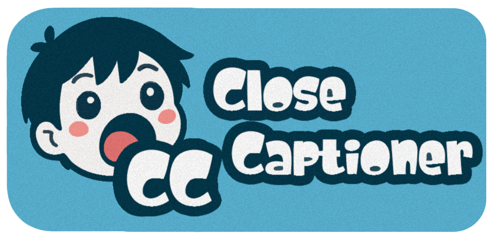

## 🇺🇸 [Read this in Portuguese](./README.pt_br.md)

# Close Captioner

**A lightweight and 100% offline extension to generate real-time subtitles from any Chrome tab's audio using local speech recognition (Vosk/WASM).**

---

## Why does this project exist?

While watching videos and live streams without native subtitles, I noticed the lack of a **simple, free tool that works 100% offline without crashing the browser**.

This extension was built to solve this issue by featuring:
- **Direct tab audio capture**
- **100% local processing** via Vosk and WebAssembly (WASM), ensuring privacy without relying on paid APIs.
- **Multi-language support** with dynamic switching directly from the popup.
- **Low resource consumption**, optimized to run smoothly on Chrome tabs.

---

## Technologies Used

- **HTML5 + CSS3 + Vanilla JavaScript**: Lightweight extension built with pure code.
- **Chrome Extensions Manifest V3**: Using `chrome.tabCapture` and `offscreen` documents to capture clean audio from the tab.
- **Vosk / WASM**: Offline speech recognition engine running inside Web Workers.
- **PowerShell**: Automation for packaging and managing language models.

---

## Installation & Setup (Windows)

Since the extension runs locally optimized AI models, you will need to download Vosk language files and package them using the included utility script.

### 1. Download Vosk Models
Go to the official [Alphacephei - Vosk Models](https://alphacephei.com/vosk/models) page and download the compact `small` models (recommended for extensions as they are lightweight and prevent memory crashes):
- Ex.: `vosk-model-small-pt-0.3.zip` (Portuguese)
- Ex.: `vosk-model-small-en-us-0.15.zip` (English)

### 2. Package Models using the Script
For each downloaded `.zip` file, open **PowerShell** from the extension's root directory and run the automation script (`tools\pack-model.ps1`):

```powershell
powershell -ExecutionPolicy Bypass -File tools\pack-model.ps1 "$env:USERPROFILE\Downloads\vosk-model-small-pt-0.3.zip"
```

- **How it works:** The script extracts the model, validates its structure, compresses it into the format expected by `vosk-browser` (`model\<language>.tar.gz`), and automatically updates `model\languages.json` with the list displayed in the extension selector.
- *Tip:* To set a custom language code, pass it as the second argument (e.g., `... pack-model.ps1 model.zip pt-br`).

### 3. Install the Extension in Chrome
1. Go to `chrome://extensions/`
2. Enable **Developer mode** (top right corner).
3. Click **"Load unpacked"** and select the project directory.

---

## How to Use

1. Open the browser tab with the video or live stream you want to subtitle.
2. Click the extension icon in the Chrome popup.
3. Choose your desired **language** from the selector.
4. Click **Start in this tab**.

*Note:* Changing the language while capture is active instantly restarts the subtitles on the same tab. Only one model remains active in memory at a time to save resources.

---

## Project Structure

```plaintext
legendas-vosk/
├── manifest.json         # Extension Manifest (MV3)
├── background.js         # Orchestrates capture, relays subtitles, and history
├── offscreen.*           # Offscreen document for audio processing
├── audio-worklet.js      # Captures the tab's audio stream
├── lib/
│   ├── vosk.js           # Vosk engine adapted for the extension
│   └── vosk-worker.js    # AI Worker running in background
├── content.js            # Injected subtitle overlay on screen
├── conversation.*        # Conversation mode / history
├── popup.* + style.css   # User interface (language selector, settings)
└── tools/
    └── pack-model.ps1    # PowerShell utility script for model packaging
```

---

## Supported Languages

The extension supports any official Vosk language model that you package inside the `model\` folder, with automatic management via `languages.json` (including Portuguese, English, Spanish, French, German, Japanese, among others).

---

## Known Limitations

- Recognition accuracy depends on Vosk's *small* models (great for general speech, but may require attention with proper nouns or highly specific jargon).
- Requires Google Chrome or Chromium-based browsers compatible with Manifest V3 architecture.